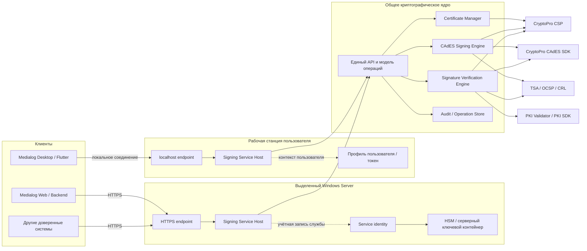
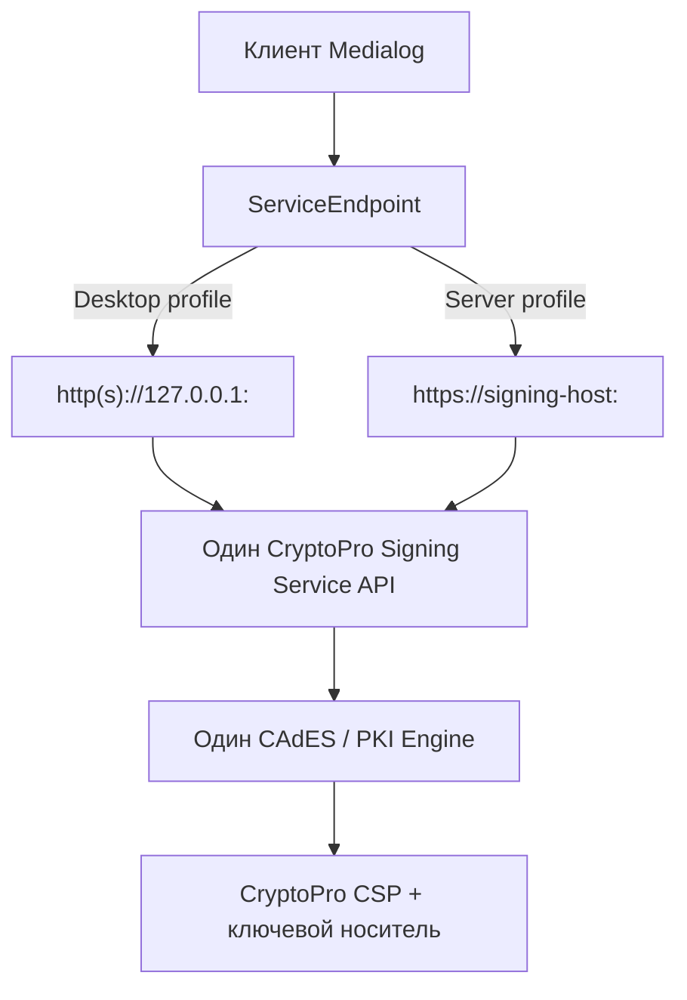
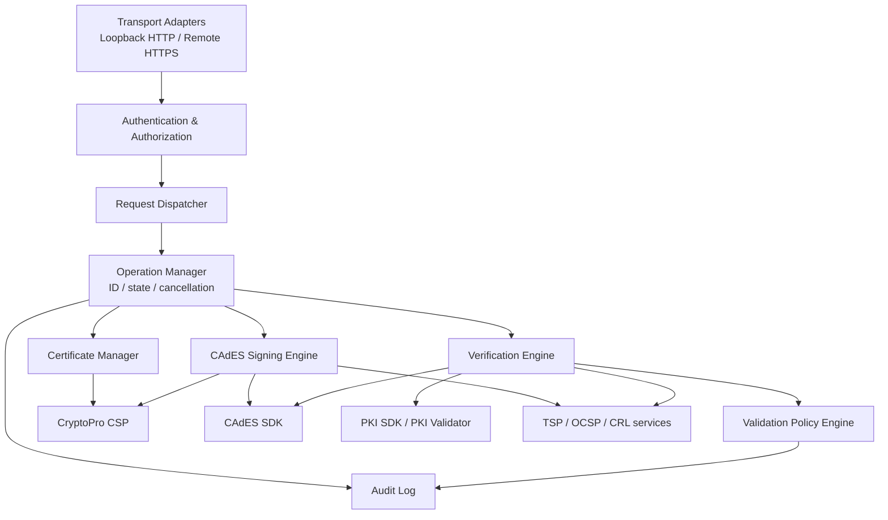
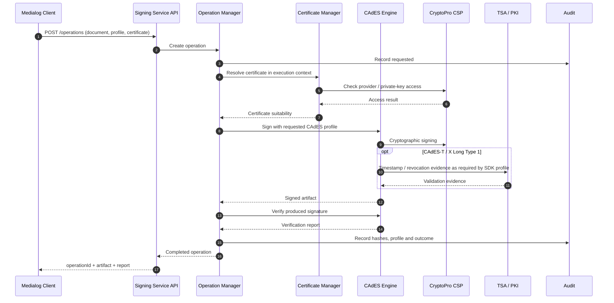
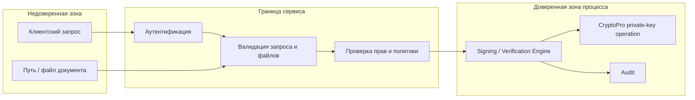

# Целевая архитектура Medialog Sign CryptoPro

> Статус: целевая архитектура, подлежит реализации и проверке. Диаграммы написаны на Mermaid и отображаются в Obsidian.

## 1. Архитектурный принцип

Продукт представляет собой **единый CryptoPro Signing Service** с единым API, единым криптографическим ядром и одинаковой моделью операций. Клиент выбирает только адрес сервиса:

- Desktop: `http://127.0.0.1:<port>` или защищённый локальный endpoint.
- Server-side: `https://<signing-host>:<port>`.

Это не два разных механизма подписания. Различается точка подключения и профиль развёртывания сервиса.

## 2. Контекстная диаграмма

## 3. Два профиля подключения одного сервиса

| Профиль | Адрес | Размещение сервиса | Типичный ключевой контекст |
|---|---|---|---|
| Desktop | localhost / loopback | Рабочая станция пользователя | Интерактивный пользователь, USB-токен или локальный контейнер |
| Server-side | HTTPS в доверенной сети | Windows Server | Выделенная service identity, HSM или серверный контейнер |

Клиентский код не должен содержать отдельную реализацию CAdES для каждого профиля. Отличается конфигурация endpoint, аутентификация и разрешённые политики доступа.

## 4. Внутренняя компонентная архитектура

Компоненты должны иметь чёткие границы:

- **Transport Adapters** принимают HTTP/JSON (или выбранный эквивалент), проверяют размер и формат запроса. Они не выполняют криптографию.
- **Authentication & Authorization** определяет вызывающую систему и права на операции, сертификаты и профили CAdES.
- **Operation Manager** создаёт стабильный `operationId`, отслеживает состояние, таймауты и отмену.
- **Certificate Manager** перечисляет сертификаты в заданном security context и сообщает пригодность для конкретной операции.
- **CAdES Signing Engine** формирует BES, T и X Long Type 1 через документированный API установленного SDK.
- **Verification Engine** проверяет подпись, атрибуты, сертификат, цепочку, отзыв и timestamp.
- **Validation Policy Engine** применяет профиль доверия Medialog/организации отдельно от криптографической целостности.
- **Audit Log** сохраняет события и результат без PIN, секретов и содержимого закрытого ключа.

## 5. Жизненный цикл операции подписания

## 6. Windows Service: да, но с учётом пользовательской сессии

Для server-side профиля рекомендуется Windows Service. Он обеспечивает автозапуск, централизованное управление, ACL, журналирование и сетевой endpoint.

Для Desktop профиля клиент также обращается к локальному endpoint. Однако **нельзя автоматически считать, что обычная Windows-служба сможет показывать PIN-диалог токена или использовать сертификаты вошедшего пользователя**:

1. Служба в Session 0 не должна рассчитывать на интерактивные диалоги.
2. `CurrentUser\\MY` внутри службы означает хранилище учётной записи службы, а не пользователя, работающего в Medialog.
3. Для USB-токенов и пользовательских контейнеров нужно проверить поддержку конкретного CSP/драйвера в выбранной модели запуска.
4. Если требуется интерактивный PIN, Desktop-профиль должен использовать пользовательский broker/agent в активной сессии. Он взаимодействует с тем же API и тем же CAdES Engine, но отвечает только за пользовательский UI и передачу разрешённого контекста.

Целевая схема развёртывания допускает два host adapter (interactive host и Windows Service host), но не два криптографических движка. Оба host используют одинаковые контракты, Operation Manager, Certificate Manager и CAdES Engine.

### Рекомендуемая модель запуска

- **Desktop:** пользовательский процесс/agent, автоматически запускаемый при входе в Windows и слушающий только loopback; при необходимости отдельная служба выполняет привилегированные фоновые задачи. Доступ к endpoint ограничивается локальным токеном сессии, проверкой Origin/Host и ACL.
- **Server-side:** Windows Service под отдельной service identity; сетевой доступ только по HTTPS, с аутентификацией клиента (mTLS или Windows Integrated Authentication в зависимости от инфраструктуры), RBAC и allowlist доверенных систем.
- Не публиковать endpoint напрямую в Интернет. Для внешних интеграций использовать VPN/reverse proxy/API gateway с ограничениями доступа.

## 7. Security boundaries

Обязательные меры:

- не принимать PIN в API и не писать его в логи;
- не экспортировать закрытые ключи;
- ограничивать размеры документов, параллелизм и время операций;
- использовать рабочую область с ACL, безопасные временные файлы и атомарную запись;
- защищаться от path traversal, reparse points, symlink/TOCTOU;
- фиксировать SHA-256 исходного и итогового артефактов;
- проверять права на каждый сертификат и каждый профиль подписи;
- хранить audit отдельно от пользовательских файлов;
- не считать доступность endpoint доказательством готовности CSP/токена.

## 8. Архитектурные решения, требующие фиксации

| Вопрос | Целевое решение | Что подтвердить |
|---|---|---|
| API | Единый versioned API | HTTP/JSON или gRPC, формат файлового обмена |
| Desktop endpoint | Loopback only | PIN UX, браузерные Origin/CSRF ограничения, user token |
| Server endpoint | HTTPS | mTLS или Windows Authentication, сертификаты клиентов |
| Windows host | Service для сервера; interactive agent для desktop при необходимости | CSP, токены, Session 0, права ключевых контейнеров |
| Хранилища | Явно задаваемый security context | CurrentUser/LocalMachine и права service identity |
| Файлы | Передача потоков или защищённые временные файлы | Лимиты размера, очистка, атомарность |
| CAdES | BES, T, X Long Type 1 | Точные функции и структуры по локальным CHM SDK |
| Доверие | Отдельный Validation Policy Engine | PKI Validator, OCSP/CRL, TSA и политика организации |

## 9. Критерии готовности архитектуры

- Один контракт API используется локально и удалённо.
- Клиент меняет endpoint, а не реализацию криптографических операций.
- Сертификаты и закрытые ключи доступны только в явно определённом security context.
- Desktop token/PIN сценарий проверен на реальном оборудовании.
- Remote endpoint защищён аутентификацией, TLS и авторизацией.
- Все три обязательных профиля CAdES реализованы и прошли независимую проверку.
- Проверка криптографической целостности отделена от доверия к цепочке и статуса отзыва.
