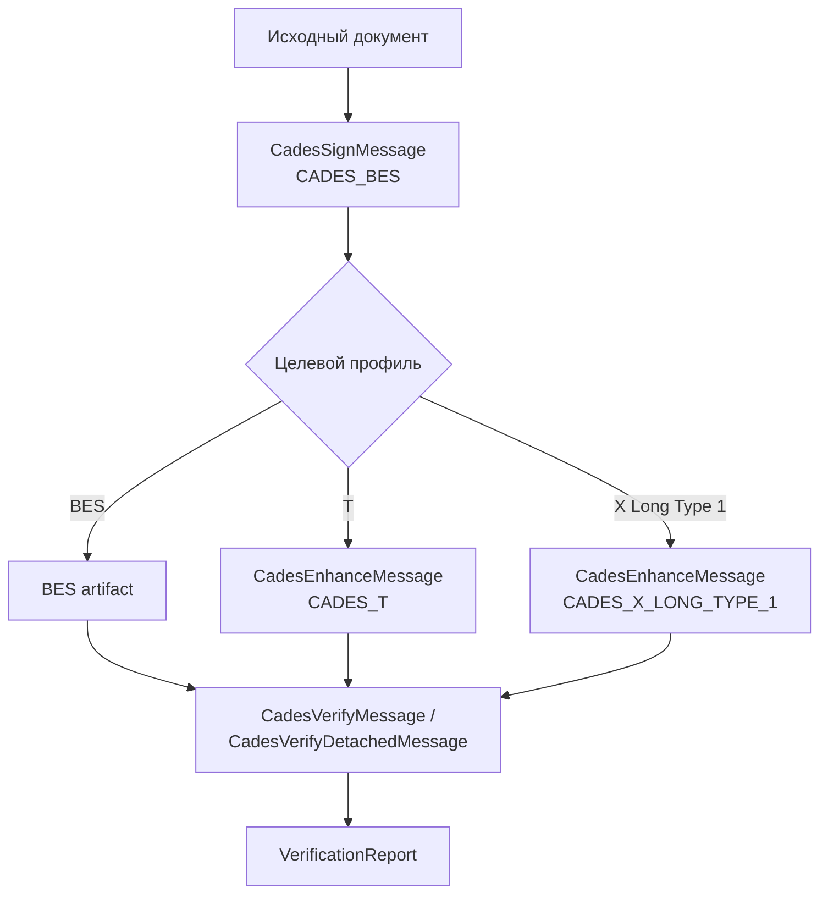

# Техническая спецификация реализации CAdES на CryptoPro C API

> Статус: implementation specification, основана на официальной документации CryptoPro CAdES C API и опубликованных примерах. Перед компиляцией необходимо сверить все структуры и прототипы с локальными `docs/pki_sdk_docs/cades.chm` и `cades.h` именно из SDK 2.0.15273.
>
> Статус: исходники Native Bridge теперь создают BES и повышают его до CAdES-T / CAdES-X Long Type 1 через `CadesEnhanceMessage`. Flutter Workbench передаёт выбранный профиль и необязательный TSP URL. Проверка принимает ожидаемый профиль. Компиляция MSVC x64 и криптографические acceptance-тесты на целевой Windows-машине ещё не выполнены.

## 1. Принятое техническое решение

Использовать **simplified C API** из `cades.h`:

- `CadesSignMessage` — создать исходную CAdES-BES подпись;
- `CadesEnhanceMessage` — повысить подпись одного signer до CAdES-T или CAdES-X Long Type 1;
- `CadesEnhanceMessageAll` — вариант повышения всех подписей в CMS, если бизнес-сценарий требует обработки всех signer;
- `CadesVerifyMessage` / `CadesVerifyDetachedMessage` — проверить attached/detached сообщение;
- `CadesFreeBlob` / `CadesFreeVerificationInfo` — освободить выделенные SDK результаты.

SDK официально поддерживает CAdES-BES, CAdES-T и CAdES-X Long Type 1. Профили вложены друг в друга: X Long Type 1 содержит свойства T, а T содержит BES.

**Рекомендуемый единый pipeline:** сначала сформировать BES, затем при необходимости повысить полученную CMS подпись до запрошенного профиля. Это даёт единый криптографический путь и позволяет повышать ранее созданные подписи без повторного подписания исходного документа.



Не нужно повторно вызывать закрытый ключ для upgrade BES → T → X Long Type 1: enhancement добавляет необходимые неподписанные атрибуты и внешние доказательства. Само усиление требует сетевых запросов к TSP/OCSP/CRL в зависимости от целевого профиля.

## 2. Профили и содержимое

| Профиль | Обязательное содержимое | Что запрашивается извне |
|---|---|---|
| CAdES-BES | CMS SignedData, signer info, подписанные атрибуты и сертификатные атрибуты согласно профилю | Не требуется TSP timestamp |
| CAdES-T | BES + signature-time-stamp | TSP |
| CAdES-X Long Type 1 | T + цепочка сертификатов, evidence проверки отзыва и timestamp на доказательства CAdES-C/sig-and-refs | TSP, OCSP и/или CRL, сертификатная цепочка |

CAdES-X Long Type 1 не следует называть CAdES-A. Для архивного профиля CAdES-A предусмотрены дополнительные архивные штампы времени. Если срок долговременного хранения превышает срок доверия к TSA/алгоритмам, потребуется отдельная стратегия архивного обновления.

## 3. Параметры SDK

### 3.1 CADES_SIGN_PARA

Официальная C API документация определяет следующие поля:

| Поле | Назначение | Правило проекта |
|---|---|---|
| `dwSize` | Размер структуры | Всегда `sizeof(CADES_SIGN_PARA)` |
| `dwCadesType` | Целевой тип | BES при базовом подписании; T/XLT1 при enhancement |
| `pSignerCert` | Сертификат подписанта | Передавать выбранный сертификат, если он доступен |
| `szHashAlgorithm` | Hash OID для идентификаторов сертификатов/CRL/OCSP | Согласовать с алгоритмами сертификата и политикой |
| `hAdditionalStore` | Дополнительное хранилище сертификатов и CRL | Использовать для необходимых промежуточных сертификатов/evidence |
| `pTspConnectionPara` | Параметры TSP | Явно задавать endpoint в управляемой конфигурации либо использовать согласованные GPO |
| `pProxyPara` | Параметры прокси | Опционально, но должно быть понятно, откуда берутся настройки |
| `pCadesExtraPara` | Дополнительные параметры подписи | Не использовать без подтверждения точного назначения в локальном CHM |
| `cAdditionalOCSPServices` | Число дополнительных OCSP endpoint | Доступно начиная с SDK 2.00.13126 |
| `rgAdditionalOCSPServices` | Массив дополнительных OCSP URL | Опционально; доступно начиная с SDK 2.00.13126 |

Указанная в репозитории версия SDK 2.0.15273 новее минимальной версии появления дополнительных OCSP endpoint. Тем не менее фактическое наличие полей и макросов необходимо проверить в заголовке поставки, используемом компилятором.

### 3.2 CADES_SERVICE_CONNECTION_PARA

Локальный заголовок SDK подтверждает `dwSize`, `wszUri`, `pAuthPara` и макро-расширение `DEFINE_ADES_STRUCT_MEMBERS`. Реализация заполняет `dwSize` и, если URL задан, `wszUri`. Официальный C++ пример enhancement инициализирует структуру так:

```cpp
CADES_SERVICE_CONNECTION_PARA tsp = { sizeof(tsp) };
tsp.wszUri = SERVICE_URL_2012;
```

Для проекта:

- `dwSize = sizeof(CADES_SERVICE_CONNECTION_PARA)`;
- `wszUri` — URL службы TSP;
- остальные поля, включая параметры аутентификации, заполнять только согласно локальному `cades.h`/CHM;
- память под URL должна жить до завершения SDK-вызова;
- не хранить логины/пароли прокси в исходниках и открытых конфигурациях.

### 3.3 CADES_ENHANCE_MESSAGE_PARA

Официальный пример использует поля:

- `dwSize`;
- `dwMsgEncodingType = X509_ASN_ENCODING | PKCS_7_ASN_ENCODING`;
- `pCadesSignPara` — указатель на подготовленную `CADES_SIGN_PARA`.

Проверено по `docs/pki_sdk_docs/SDK/include/cades.h`: typedef содержит `dwSize`, `dwMsgEncodingType`, `pCadesSignPara` и `DEFINE_ADES_STRUCT_MEMBERS`.

### 3.4 CADES_VERIFICATION_PARA

Важные поля:

- `dwSize`;
- `pProxyPara`;
- `hStore`;
- зарезервированные поля должны оставаться в значениях, требуемых SDK;
- `dwCadesType` — тип, соответствие которому нужно проверить;
- `dwFlags` — дополнительные флаги, если соответствующие поля включены в заголовок.

Для server-side сценария документация описывает `CADES_SKIP_IE_PROXY_CONFIGURATION` (0x00000004), чтобы не запрашивать настройки proxy из IE. Поле `dwFlags` доступно при сборке с `CADES_PARA_HAS_EXTRA_FIELDS`; наличие и способ определения этого макроса проверить в поставленном заголовке.

При проверке X Long Type 1 внутренние данные сертификатов и отзыва содержатся в подписи; `hStore` используется для проверки внешнего timestamp.

## 4. Алгоритм создания

### 4.1 Шаг 1: создать BES

Сохранить существующий pipeline `CadesSignMessage`:

1. Получить выбранный `PCCERT_CONTEXT`.
2. Проверить наличие связи с закрытым ключом и затем фактическую доступность ключа.
3. Выбрать hash OID согласно алгоритму сертификата/политике.
4. Заполнить `CRYPT_SIGN_MESSAGE_PARA`.
5. Заполнить `CADES_SIGN_PARA` с `dwCadesType = CADES_BES`.
6. Связать структуры через `CADES_SIGN_MESSAGE_PARA`.
7. Вызвать `CadesSignMessage` с корректным detached flag.
8. Скопировать результат в управляемый буфер и освободить SDK blob через `CadesFreeBlob`.

### 4.2 Шаг 2: повысить BES до T или X Long Type 1

Для выбранного signer использовать `CadesEnhanceMessage`. Официальный пример C++ для повышения BES до X Long Type 1 показывает следующую форму вызова:

```cpp
CADES_SERVICE_CONNECTION_PARA tsp = { sizeof(tsp) };
tsp.wszUri = SERVICE_URL_2012;

CADES_SIGN_PARA signPara = { sizeof(signPara) };
signPara.dwCadesType = CADES_X_LONG_TYPE_1;
signPara.pTspConnectionPara = &tsp;

CADES_ENHANCE_MESSAGE_PARA enhancePara = { sizeof(enhancePara) };
enhancePara.dwMsgEncodingType = X509_ASN_ENCODING | PKCS_7_ASN_ENCODING;
enhancePara.pCadesSignPara = &signPara;

PCRYPT_DATA_BLOB enhancedBlob = nullptr;
BOOL ok = CadesEnhanceMessage(
    &enhancePara,
    0,                  // signer index
    signedMessage.data(),
    static_cast<DWORD>(signedMessage.size()),
    &enhancedBlob);
```

Это иллюстрация документированного вызова, а не готовая функция для копирования без сверки прототипа. В реальном коде:

- проверить размер CMS до преобразования в DWORD;
- проверить `ok` и немедленно сохранить `GetLastError()` при ошибке;
- проверить `enhancedBlob != nullptr` при успехе;
- скопировать `pbData/cbData` в собственный буфер;
- освободить blob строго через `CadesFreeBlob`;
- не изменять исходный CMS буфер до успешного завершения и проверки результата.

Для CAdES-T использовать тот же pipeline с `dwCadesType = CADES_T`. Для X Long Type 1 — `dwCadesType = CADES_X_LONG_TYPE_1`. Значения enum брать из установленного `cades.h`, а не захардкоживать числа в прикладном коде.

Если CMS содержит несколько подписантов, решить бизнес-правило: улучшать только выбранную подпись через `CadesEnhanceMessage` и signer index либо все подписи через `CadesEnhanceMessageAll`. Не улучшать все подписи автоматически без явного требования.

### 4.3 Attached и detached

- Для attached BES результат содержит подписанные данные внутри CMS. Enhancement получает этот CMS blob.
- Для detached BES исходные данные и CMS подпись хранятся отдельно. Enhancement применяется к CMS подписи; исходный документ сохраняется неизменным и отдельно передаётся в detached verification.
- Проверка результата должна повторно использовать правильный режим и тот же исходный документ.

## 5. Алгоритм проверки

Для каждого профиля формировать `CADES_VERIFICATION_PARA` и задавать явный `dwCadesType`.

| Профиль | `dwCadesType` при проверке |
|---|---|
| BES | `CADES_BES` |
| T | `CADES_T` |
| X Long Type 1 | `CADES_X_LONG_TYPE_1` |

Далее:

1. Заполнить `CRYPT_VERIFY_MESSAGE_PARA` с `X509_ASN_ENCODING | PKCS_7_ASN_ENCODING`.
2. Заполнить `CADES_VERIFICATION_PARA`.
3. Заполнить `CADES_VERIFY_MESSAGE_PARA`.
4. Вызвать `CadesVerifyMessage` для attached либо `CadesVerifyDetachedMessage` для detached.
5. Считать `CADES_VERIFICATION_INFO.dwStatus`.
6. Проверить, что API call успешен и статус равен `CADES_VERIFY_SUCCESS`.
7. Сохранить диагностические поля signer, signing time, timestamp и код статуса, если они доступны.
8. Освободить decoded content через `CadesFreeBlob`, verification info через `CadesFreeVerificationInfo`.

Важно: `CadesMsgIsType` и `CadesMsgIsTypeEncoded` проверяют признаки типа по наличию атрибутов. Они не заменяют криптографическую проверку. X Long Type 1 является частным случаем BES, поэтому проверка только на BES не доказывает, что подпись достигла требуемого уровня X Long Type 1.

### VerificationReport

Минимальная схема результата:

```json
{
  "requestedProfile": "CAdES-X Long Type 1",
  "detectedProfile": "CAdES-X Long Type 1",
  "apiCallSucceeded": true,
  "cryptographicIntegrity": "valid",
  "profileCompliance": "valid",
  "signerCertificate": "valid",
  "chainTrust": "trusted",
  "revocation": "good",
  "signatureTimestamp": "valid",
  "evidenceTimestamp": "valid",
  "longTermEvidence": "complete",
  "policyDecision": "accepted",
  "sdkStatusCode": 0
}
```

Значения иллюстративны. Каждое поле должно поддерживать `valid`, `invalid`, `unknown`, `not_checked`, `not_applicable`. Не превращать сетевой timeout или отсутствие OCSP ответа в статус `good`.

## 6. TSP, OCSP, CRL и лицензии

- CAdES-T требует получения и проверки signature timestamp через TSP.
- CAdES-X Long Type 1 дополнительно собирает и включает сертификатную цепочку и доказательства статуса отзыва, а также timestamp на доказательства.
- CryptoPro CAdES SDK использует CryptoPro TSP Client и OCSP Client для timestamp и статусов; прикладному коду не следует вручную собирать ASN.1 атрибуты, если штатный SDK выполняет эту работу.
- На целевых машинах должны быть установлены и лицензированы TSP Client и OCSP Client в соответствии с лицензией продукта и правилами поставки.
- Если TSP/OCSP лицензия отсутствует или истекла, SDK документирует соответствующие ошибки (например, 0xC2100140 / 0xC2110140).
- Нужно проверить сетевой доступ к TSP/OCSP/CRL из security context процесса Signing Service. Рабочая станция и Windows Service могут иметь разные proxy, GPO, сертификаты и доступ в сеть.
- Не зашивать публичный тестовый TSP URL как production default. Endpoint задаётся конфигурацией окружения и проходит health/acceptance test.

## 7. Обработка ошибок

Ошибки разделить на категории:

| Категория | Примеры | Поведение |
|---|---|---|
| SDK/API | CAdES call failed, invalid parameters | Возвратить SDK/Win32 code и correlation ID |
| TSP | timeout, недоступен endpoint, плохой TSA response | Не выдавать результат как T/X Long Type 1 |
| OCSP/CRL | revoked, unknown, responder unavailable, stale | Отразить конкретный статус; не подменять unknown на good |
| Certificate | нет цепочки, истёк сертификат, нет EKU/Key Usage | Применить policy и вернуть подробный report |
| Profile | фактический тип ниже запрошенного | Отказать в успешном завершении |
| Output | не удалось записать результат | Не публиковать частичный файл как готовую подпись |

Сохранять `GetLastError()` немедленно после неудачного вызова CAdES. Не вызывать до этого функции, которые могут изменить last error.

## 8. Изменения в Native Bridge

Рекомендуемые внутренние функции:

```cpp
SignResult SignBes(..., bool detached);
SignResult EnhanceSignature(
    const ByteBuffer& inputCms,
    CadesProfile targetProfile,
    uint32_t signerIndex,
    const CadesNetworkConfig& network);
VerificationReport VerifyCades(
    const ByteBuffer& cms,
    const std::optional<ByteBuffer>& detachedContent,
    CadesProfile expectedProfile,
    const CadesVerificationConfig& verification);
```

Публичная операция может оставаться одной:

```json
{
  "action": "sign",
  "profile": "CAdES-X Long Type 1",
  "detached": true,
  "inputPath": "document.bin",
  "outputPath": "document.p7s",
  "thumbprint": "..."
}
```

Bridge сам выполняет BES → enhancement → verification. Клиент не должен управлять внутренними вызовами SDK. Добавить отдельную операцию `upgrade-signature` для повышения уже существующего BES/T без повторного подписания документа.

## 9. Acceptance tests

### BES
- Attached и detached подпись.
- Проверка целостности и независимым валидатором.
- Повреждение документа и CMS.
- Сертификат без доступного private key, токен отключён, неверный PIN.

### T
- BES → T.
- Наличие signature timestamp и проверка TSA.
- Неверный/недоступный TSA, timeout, неправильная подпись ответа.
- Проверка, что при ошибке TSP не возвращается успешный T artifact.

### X Long Type 1
- BES → X Long Type 1.
- BES → T → X Long Type 1.
- Включение chain/evidence и CAdES-C timestamp.
- Проверка OCSP good/revoked/unknown/unavailable и CRL good/expired/unavailable.
- Проверка после истечения срока сертификата подписанта при наличии корректных исторических evidence.
- Проверка на другой машине без исходного профиля пользователя, но с корректными trust anchors.
- Независимая проверка формата и содержимого evidence.

### Общие
- Один signer и несколько signer.
- Attached/detached, если конкретная операция поддерживается SDK.
- Разрыв сети во время enhancement.
- Повтор операции и защита от частичного результата.
- Проверка больших документов и пределов DWORD/буферов.
- Тестирование в Desktop user context и Windows Service identity.

## 10. Ссылки на официальные материалы

- [CAdES SDK Reference](https://docs.cryptopro.ru/cades/reference)
- [CAdES SDK Usage](https://docs.cryptopro.ru/cades/usage)
- [CADES_SIGN_PARA](https://docs.cryptopro.ru/cades/reference/cadesc/cadesc-struct/cades_sign_para)
- [CADES_VERIFICATION_PARA](https://docs.cryptopro.ru/cades/reference/cadesc/cadesc-struct/cades_verification_para)
- [CAdES-BES → CAdES-X Long Type 1: C++ simplified API sample](https://docs.cryptopro.ru/cades/reference/cadesc/cadesc-samples/samplesimplifiedapienhancecadesbes)
- [CAdES API function/structure index](https://docs.cryptopro.ru/cades/reference/cadesc/cadesc-lib)
- [CAdES-BES verification sample](https://docs.cryptopro.ru/cades/reference/cadesc/cadesc-samples/samplesimplifiedapiverifycadesbes)
- [TSP/OCSP Client licensing](https://docs.cryptopro.ru/cades/usage/cadeslicense)

## 11. Статус реализации в исходниках

В `native/src/main.cpp` реализовано:

- создание базовой attached/detached CAdES-BES подписи через `CadesSignMessage`;
- повышение выбранного signer до CAdES-T или CAdES-X Long Type 1 через `CadesEnhanceMessage`;
- передача опционального TSP URL через `CADES_SERVICE_CONNECTION_PARA`; если URL не передан, SDK использует настроенную системную конфигурацию;
- освобождение исходного и итогового blob через `CadesFreeBlob`;
- выбор ожидаемого профиля при проверке и извлечение `pSignatureTimeStampTime`.

В исходнике добавлены x64 `static_assert` для ABI размеров `CADES_SERVICE_CONNECTION_PARA`, `CADES_SIGN_PARA`, `CADES_ENHANCE_MESSAGE_PARA` и `CADES_VERIFICATION_PARA`. Они намеренно заставят сборку завершиться ошибкой, если compile-time макросы изменят layout структур.

Это реализация в исходниках, не подтверждение успешной компиляции или криптографической корректности артефактов. Multi-signer, upgrade уже существующего файла подписи отдельной командой, полноценный VerificationReport, OCSP/proxy policy и серверный transport остаются следующими этапами.

## 12. Открытые пункты перед production-проверкой

- [x] Сверить typedef `CADES_ENHANCE_MESSAGE_PARA` с локальным `cades.h`.
- [x] Сверить typedef `CADES_SERVICE_CONNECTION_PARA` и auth fields.
- [x] Сверить C API prototype для `CadesEnhanceMessage` и `CadesEnhanceMessageAll`.
- [x] Проверить enum constants из `cades.h` SDK 2.0.15273.
- [ ] Проверить macro `CADES_PARA_HAS_EXTRA_FIELDS` и `CADES_SKIP_IE_PROXY_CONFIGURATION`.
- [ ] Зафиксировать TSP/OCSP license prerequisites и тестовые endpoint.
- [ ] Выполнить build и реальные тесты на Windows с CryptoPro CSP/CAdES runtime.

До закрытия этих пунктов спецификация определяет архитектуру и pipeline, но не считается подтверждением бинарной ABI-совместимости каждого поля для конкретной поставки.
