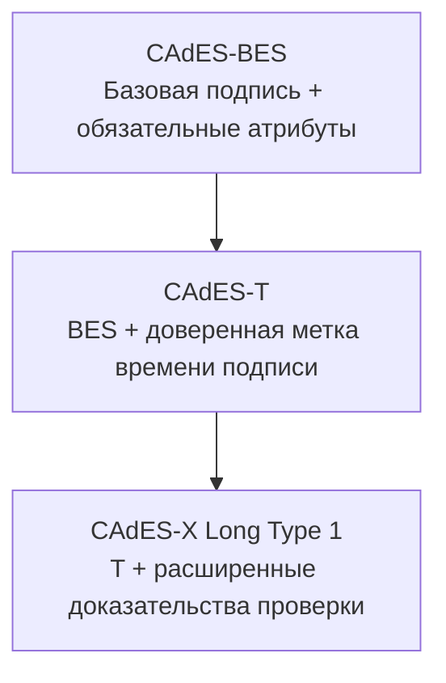

# Профили электронной подписи CAdES

> Обязательный объём промышленного релиза: CAdES-BES, CAdES-T и CAdES-X Long Type 1.
>
> SDK reference source of truth: `docs/pki_sdk_docs/cades.chm`, `CpPkiSdk.chm`, `pkivalidator.chm` и дистрибутив `cadessdk_2.0.15273.msi`. Перед реализацией каждой функции необходимо сверять точные сигнатуры, параметры, ownership памяти и коды ошибок с этой поставкой SDK. Не переносить сигнатуры из другой версии SDK без проверки.

## 1. Лестница профилей



| Профиль | Смысл | Внешние зависимости | Статус текущего Bridge |
|---|---|---|---|
| CAdES-BES | Базовая CAdES подпись | CSP/CAdES SDK | Реализованы вызовы BES для attached/detached; сборка и тесты не подтверждены |
| CAdES-T | BES с доверенной меткой времени подписи | TSA/TSP и корректная проверка TSA | Не реализован |
| CAdES-X Long Type 1 | Расширенная подпись с долгосрочными доказательствами проверки согласно профилю SDK | TSA, сведения о сертификатах и статусах отзыва, доступность PKI источников | Не реализован |

## 2. Общий контракт операции

Профиль должен передаваться явно, а не определяться неявно по расширению файла.

Пример концептуального запроса:

```json
{
  "action": "sign",
  "profile": "CAdES-T",
  "input": { "type": "file", "path": "..." },
  "output": { "type": "file", "path": "..." },
  "certificate": { "thumbprint": "..." },
  "timestamp": { "policy": "required" }
}
```

Это проектный пример контракта, не описание уже реализованного протокола. Финальный API должен поддерживать versioning, operationId, идемпотентность и подробный структурированный результат.

## 3. Реализация по этапам

### 3.1 CAdES-BES

- Сохранить текущие attached и detached сценарии.
- Проверить обязательные атрибуты и соответствие профилю по SDK.
- Поддержать согласованный набор алгоритмов и OID, не полагаться на эвристики только по OID открытого ключа.
- Реализовать проверку результата сразу после подписания.
- Проверить на тестовых сертификатах и реальных носителях.
- Проверить совместимость с независимыми валидаторами и принимающими системами.

**Критерий готовности:** обе формы BES подписываются и проверяются на целевых Windows/CSP/SDK версиях, а негативные тесты обнаруживают повреждение данных и подписи.

### 3.2 CAdES-T

- Изучить в `cades.chm` и `CpPkiSdk.chm` штатный механизм добавления signature timestamp.
- Использовать SDK API, а не вручную собирать CMS/CAdES атрибуты.
- Ввести конфигурацию TSA: URL, политика, таймауты, proxy при необходимости. Секреты и приватные параметры не хранить в открытом виде.
- Проверять подпись ответа TSA, цепочку TSA и допустимость алгоритмов.
- Разделять ошибки подписания и ошибки TSA.
- Предусмотреть политику: timestamp required (операция завершается ошибкой при недоступности TSA) либо optional только если это разрешено бизнес-процессом.
- Возвращать TSA identity, generationTime, policy OID и результат проверки timestamp, если эти данные доступны из SDK.
- Тестировать неправильный ответ TSA, таймаут, недоверенный TSA сертификат и timestamp с некорректной подписью.

**Критерий готовности:** timestamp создаётся, проверяется и сохраняется в подписи; при обязательной политике отказ TSA не приводит к выдаче результата как CAdES-T.

### 3.3 CAdES-X Long Type 1

- Сверить точное определение профиля и поддерживаемые операции с CHM именно установленной версии SDK.
- Определить поддерживаемые SDK операции добавления и проверки долгосрочных validation data.
- Получать сертификатную цепочку и сведения об отзыве из предусмотренных SDK источников/механизмов.
- Проверять и фиксировать временную привязку evidence и timestamp.
- Реализовать обработку недоступности OCSP/CRL/TSA и истёкших ответов.
- Не заявлять Long Type 1, если необходимые доказательства не добавлены или не прошли проверку.
- Сохранить полный VerificationReport с результатами по каждому signer и каждому доказательству.

**Критерий готовности:** подпись подтверждена как X Long Type 1 по правилам SDK, включает требуемые для профиля доказательства, успешно проверяется после перезапуска и на независимом валидаторе, а также проходит тесты с истёкшими/отозванными сертификатами и недоступными службами.

## 4. Модель результата проверки

Не сводить результат к одному bool:

```json
{
  "cryptographicIntegrity": "valid",
  "cadesProfile": "CAdES-X Long Type 1",
  "profileCompliance": "valid",
  "signerCertificate": "valid",
  "chainTrust": "trusted",
  "revocation": "good",
  "signatureTimestamp": "valid",
  "longTermEvidence": "complete",
  "policy": "accepted"
}
```

Значения выше иллюстративны. Реальная схема должна использовать перечисления и коды SDK, отдельно кодируя `valid`, `invalid`, `unknown`, `not_checked` и `not_applicable`.

## 5. Общие тестовые сценарии

- Attached и detached для каждого поддерживаемого профиля, если это предусмотрено SDK.
- GOST алгоритмы и комбинации сертификатов, реально используемые организацией.
- Сертификат без private key, недоступный контейнер, извлечённый токен, неверный PIN.
- TSA timeout, TSA отказ, некорректный/недоверенный TSA response.
- OCSP/CRL: good, revoked, unknown, responder unavailable, stale response.
- Истёкший signer certificate и проверка на момент подписания.
- Повреждение документа, подписи, timestamp и validation evidence.
- Несколько подписантов, если поддерживаются API и бизнес-процессом.
- Повторная проверка после длительного периода и на другой машине.

## 6. SDK источники в репозитории

- [CAdES SDK CHM](pki_sdk_docs/cades.chm)
- [PKI SDK CHM](pki_sdk_docs/CpPkiSdk.chm)
- [PKI Validator CHM](pki_sdk_docs/pkivalidator.chm)
- [CAdES SDK installer](pki_sdk_docs/cadessdk_2.0.15273.msi)

Бинарные CHM/MSI хранятся в репозитории как исходная поставка документации и SDK. Для Obsidian они доступны как вложенные файлы, но текстовые решения, архитектура и планы реализации должны оставаться в Markdown.
