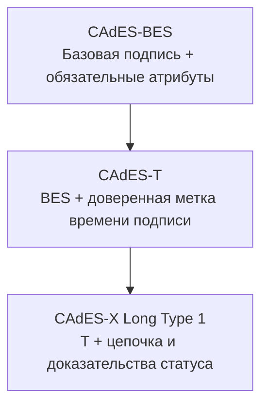

# Профили электронной подписи CAdES

> Обязательный объём промышленного релиза: CAdES-BES, CAdES-T и CAdES-X Long Type 1.
>
> Подробная реализационная спецификация: [[CADES_IMPLEMENTATION_SPEC]]. Локальная поставка SDK находится в `docs/pki_sdk_docs/`.

## 1. Лестница профилей

| Профиль | Смысл | Внешние зависимости | Статус текущего Bridge |
|---|---|---|---|
| CAdES-BES | Базовая CAdES подпись | CSP/CAdES SDK | Реализованы вызовы BES для attached/detached; сборка и тесты не подтверждены |
| CAdES-T | BES с signature timestamp | TSP Client, TSA | Не реализован |
| CAdES-X Long Type 1 | T + сертификатная цепочка и revocation evidence + timestamp на evidence | TSP Client, OCSP Client, CRL/PKI | Не реализован |

## 2. Принятая реализация через C API

Используем simplified C API:

1. `CadesSignMessage` создаёт CAdES-BES.
2. `CadesEnhanceMessage` повышает выбранную подпись до `CADES_T` или `CADES_X_LONG_TYPE_1`.
3. `CadesVerifyMessage` / `CadesVerifyDetachedMessage` проверяют итоговый профиль.
4. Результаты SDK освобождаются соответствующими функциями `CadesFreeBlob` и `CadesFreeVerificationInfo`.

`CadesEnhanceMessageAll` предназначена для сценария, где нужно повышать всех signer в CMS. Выбор одного signer или всех должен быть явным параметром операции.

## 3. CAdES-BES

- Attached и detached signing.
- Обязательные атрибуты по профилю.
- Проверка криптографической целостности.
- Поддержка согласованных GOST алгоритмов.
- Независимая проверка на принимающей стороне.

**Готовность:** обе формы создаются и проверяются на целевых версиях CSP/SDK/runtime.

## 4. CAdES-T

- Исходная BES подпись.
- Enhancement через `CadesEnhanceMessage` с `CADES_SIGN_PARA.dwCadesType = CADES_T`.
- Настроенный TSP endpoint через `CADES_SERVICE_CONNECTION_PARA` либо согласованную GPO конфигурацию.
- Проверка TSA response и TSA certificate chain.
- При обязательной политике timestamp ошибка TSP должна завершать операцию ошибкой, а не возвращать результат как T.

**Готовность:** signature timestamp реально встроен, валиден и проверяется SDK/независимым валидатором.

## 5. CAdES-X Long Type 1

- BES или T подпись повышается через `CadesEnhanceMessage` до `CADES_X_LONG_TYPE_1`.
- SDK собирает сертификатную цепочку и сведения о статусе отзыва (OCSP/CRL).
- В подпись добавляются необходимые значения и ссылки на доказательства, а также timestamp на доказательства.
- Не заявлять X Long Type 1 при неполных evidence или ошибках TSP/OCSP.
- Проверять историческую валидность на момент подписи и временную привязку evidence.

**Важно:** CAdES-X Long Type 1 не равен CAdES-A. Для архивного профиля CAdES-A предусмотрены дополнительные архивные штампы времени.

**Готовность:** SDK подтверждает X Long Type 1, все требуемые evidence присутствуют и подпись проходит независимую проверку.

## 6. Модель результата проверки

Не сводить результат к одному bool. Минимальные поля:

- cryptographicIntegrity;
- detectedProfile / requestedProfile;
- profileCompliance;
- signerCertificate;
- chainTrust;
- revocation;
- signatureTimestamp;
- evidenceTimestamp;
- longTermEvidence;
- policyDecision;
- sdkStatusCode.

Для статусов использовать `valid`, `invalid`, `unknown`, `not_checked`, `not_applicable`.

## 7. Зависимости и лицензии

Для CAdES-T нужен TSP Client и доступ к TSA. Для X Long Type 1 также нужны источники сведений об отзыве и работа OCSP Client/CRL. На целевой машине должны быть установлены действующие лицензии CryptoPro TSP Client и OCSP Client согласно условиям CryptoPro. Отсутствующая/истёкшая лицензия должна отображаться как ошибка окружения, не как ошибка документа.

## 8. Тесты

- Attached/detached BES.
- BES → T и проверка timestamp.
- BES → X Long Type 1.
- BES → T → X Long Type 1.
- TSP timeout / недоступность / недоверенный TSA.
- OCSP good / revoked / unknown / unavailable.
- CRL good / expired / unavailable.
- Повреждение данных и подписи.
- Проверка после истечения сертификата подписанта.
- Независимая проверка и другая Windows машина.

