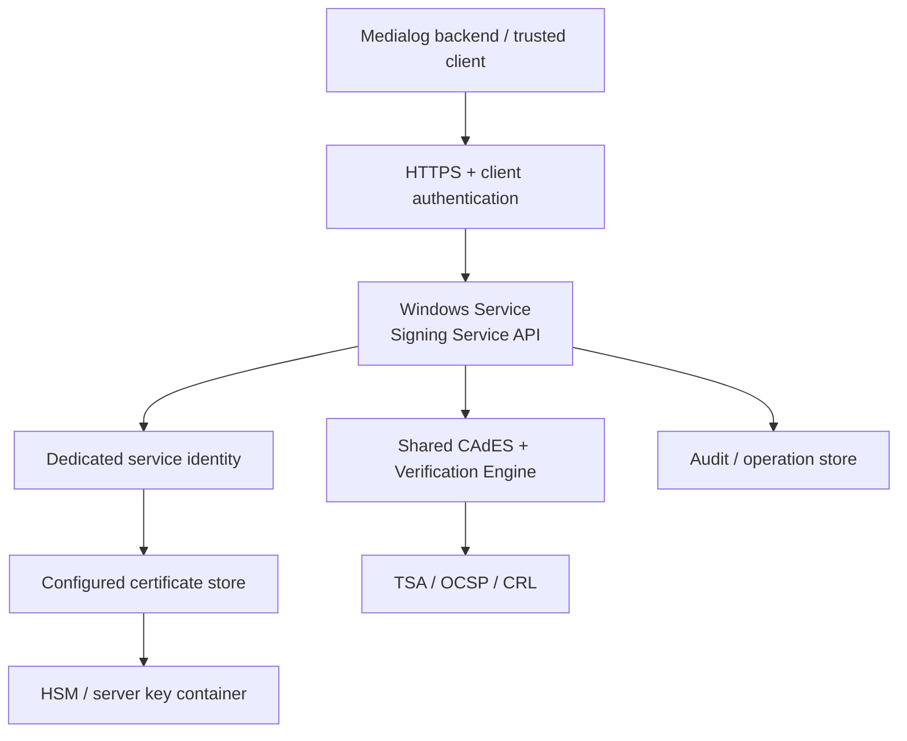

# Windows hosting: Desktop и Server-side

## Единый сервис, разные host profiles

Desktop и Server-side используют один CryptoPro Signing Service API и одно криптографическое ядро. Отличаются endpoint, host process и security context.

- Desktop: клиент обращается к loopback endpoint на рабочей станции.
- Server-side: клиент обращается к тому же API по HTTPS на Windows Server.

Подробная схема и Mermaid диаграммы: [Целевая архитектура](ARCHITECTURE.md).

## Desktop profile

Типичный сценарий: Flutter/Medialog запущен в интерактивной сессии пользователя, сертификат и токен доступны этому пользователю.

Рекомендуемый вариант для токенов с PIN UI — пользовательский agent/host, запускаемый при входе в Windows и слушающий только loopback. Он использует общий API и общий CAdES Engine. При необходимости отдельная служба может выполнять фоновые задачи, но не должна перехватывать интерактивный PIN flow.

Обязательно проверить:
- доступ к `CurrentUser\\MY` именно интерактивного пользователя;
- работу токена и PIN prompt;
- блокировку/разблокировку сессии;
- RDP disconnect/reconnect/logoff, если это целевая среда;
- запрет доступа к локальному endpoint посторонним локальным процессам/сайтам.

## Server-side profile

Для централизованного серверного подписания рекомендуется Windows Service под отдельной service identity.

Сервис должен:
- запускаться автоматически и корректно восстанавливаться после сбоя;
- слушать только заданные сетевые интерфейсы;
- использовать HTTPS и аутентификацию клиентов (mTLS либо Windows Integrated Authentication согласно инфраструктуре);
- применять RBAC и allowlist доверенных интеграций;
- иметь явно настроенный доступ к сертификатам и закрытым ключам;
- писать audit и operation state;
- не зависеть от интерактивного рабочего стола и PIN-диалогов.

Схема:

## Важные ограничения Windows

1. Windows Service обычно работает в Session 0. Не рассчитывать на интерактивные диалоги, ввод PIN или подтверждение на экране.
2. `CurrentUser\\MY` внутри службы относится к профилю service identity, а не к пользователю, отправившему запрос.
3. Для `LocalMachine\\MY` и ключевых контейнеров необходимо явно назначить права service identity.
4. Поддержка USB-токена, PIN cache, HSM и non-interactive signing зависит от CSP, драйвера, устройства и политики безопасности. Это нужно проверять на конкретной конфигурации.
5. Если ключ требует интерактивного PIN, не обходить это хранением PIN в конфиге, переменной среды, командной строке или API.
6. Не открывать endpoint в Интернет напрямую. Для внешних систем использовать VPN/API gateway/reverse proxy и строгую аутентификацию.

## Приёмочные проверки

- Чистая установка CSP и CAdES runtime.
- Desktop: интерактивный пользователь, token connect/disconnect, PIN UX, блокировка сессии.
- Server: service account, загрузка профиля, права на сертификат/контейнер, reboot и recovery.
- TLS, клиентская аутентификация, RBAC и отказ неавторизованному клиенту.
- TSA/OCSP/CRL: доступность, timeout, недоверенный ответ.
- Конкурентные операции, cancellation, повтор запроса и idempotency.
- Проверка, что локальный и сетевой endpoint возвращают одинаковые контракты и результаты для одинаковых операций.

## Целевые ОС

Планируемые системы: Windows 10/11 и Windows Server x64. Поддержка каждой версии подтверждается только после проверки матрицы CSP/CAdES runtime/драйверов и реальных испытаний. Само наличие Windows в списке не означает сертифицированную совместимость.
